<!-- Generated by GitHub Profile Agent Console. Edit profile.config.json, then run npm run generate. -->

  <picture>
    <source media="(max-width: 760px) and (prefers-color-scheme: dark)" srcset="./assets/hero/agent-console-c243feae-mobile-dark.svg">
    <source media="(max-width: 760px)" srcset="./assets/hero/agent-console-c243feae-mobile-light.svg">
    <source media="(prefers-color-scheme: dark)" srcset="./assets/hero/agent-console-c243feae-dark.svg">
    <source media="(prefers-color-scheme: light)" srcset="./assets/hero/agent-console-c243feae-light.svg">
    
  </picture>

  <a href="https://linkedin.com/in/muhasgarfatwahyudi">LinkedIn</a> · <a href="https://mail.google.com/mail/?view=cm&fs=1&to=afatwahyudi@gmail.com">Email</a> · <a href="https://t.me/asgar_disiniii">Telegram</a> · <a href="https://wa.me/6282293560277">WhatsApp</a>

---

Full-stack developer in Kendari, Indonesia. Most of my day-to-day work is in **Go** on the backend and **Vue.js / React** on the frontend, alongside practical **Gemini API** integrations.

Currently interning as a Software Engineer (Prakom) at **BPVP Kendari** and co-founding **A2Developer Kendari**, where we build client web apps and run local coding courses.

### Selected Work

- [**Teman Curhat AI**](https://github.com/Asgarnet11/Teman-Curhat-AI) — An AI chatbot built with Python, Streamlit, and the Gemini API, offering a conversational space for emotional support. Actively maintained and under continuous development.
- [**Go StarterPack**](https://github.com/Asgarnet11/StarterPack-Golang-ByAsgar) — A reusable REST API starter kit in Go, structured with clean architecture to speed up the setup of new backend projects.
- [**Web Desa**](https://github.com/Asgarnet11/web-desa) — Village information and portal web application built with Laravel and Blade.
- [**My Portfolio**](https://github.com/Asgarnet11/my-portfolio) — Personal developer portfolio built with React and TypeScript. · [Live](https://asgarnet.vercel.app)
- [**Vokasi App**](https://github.com/Asgarnet11/vokasi_app) — Vocational application project built with Python.

### Stack

- **Backend:** `Go` · `Laravel` · `CodeIgniter` · `Python`
- **Frontend:** `Vue.js` · `React` · `TypeScript`
- **Data & Infra:** `MySQL` · `Git` · `Docker` · `Linux`

### Contributions

<picture>
  <source media="(prefers-color-scheme: dark)" srcset="https://raw.githubusercontent.com/Asgarnet11/Asgarnet11/output/github-contribution-grid-snake-dark.svg">
  <source media="(prefers-color-scheme: light)" srcset="https://raw.githubusercontent.com/Asgarnet11/Asgarnet11/output/github-contribution-grid-snake.svg">
  
</picture>

GitHub Stats &amp; Top Languages

 

  
  

### Recent Activity

<!-- AUTO:ACTIVITY:START -->
- Nov 26, 2026: pushed 1 commit to [Asgarnet11/web-desa](https://github.com/Asgarnet11/web-desa).
- Nov 28, 2026: pushed 1 commit to [Asgarnet11/my-portfolio](https://github.com/Asgarnet11/my-portfolio).
- Nov 28, 2026: closed issue [#3](https://github.com/Asgarnet11/Asgarnet11/issues/3) in [Asgarnet11/Asgarnet11](https://github.com/Asgarnet11/Asgarnet11).
- Nov 28, 2026: opened issue [#3](https://github.com/Asgarnet11/Asgarnet11/issues/3) in [Asgarnet11/Asgarnet11](https://github.com/Asgarnet11/Asgarnet11).
- Nov 28, 2026: merged pull request [#2](https://github.com/Asgarnet11/Asgarnet11) in [Asgarnet11/Asgarnet11](https://github.com/Asgarnet11/Asgarnet11).
<!-- AUTO:ACTIVITY:END -->

---

  Kendari, Indonesia · Open to work & freelance

